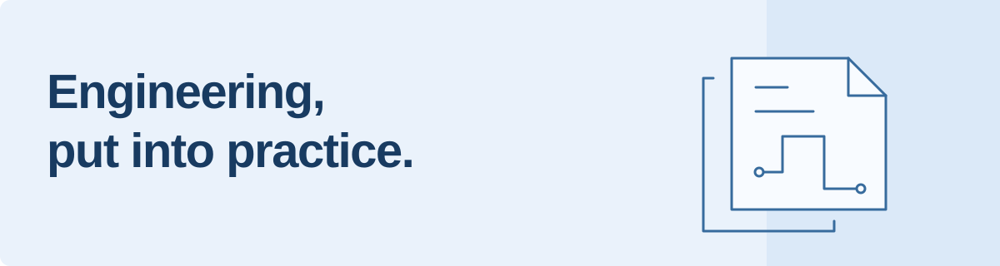

# Hi, I'm Caleb.

I build practical tools that connect hardware and software. This is a home for my engineering projects, experiments, and the things I learn along the way.

[Project overview](https://github.com/KVGT86/Project_portfolio/blob/main/Projects_Overview.pdf) · [Explore my repositories](https://github.com/KVGT86?tab=repositories)

## Selected projects

| Project | What you'll find |
| :--- | :--- |
| **[HuionNote](https://github.com/KVGT86/huion-note-tools)** | A Linux workspace for the Huion Note X10: notebook sync, a live digital canvas, and handwriting transcription. |
| **[Engineering portfolio](https://github.com/KVGT86/Project_portfolio)** | Previous projects, with Python, C/C++, and Arduino code. Start with the overview PDF for a quick look. |
| **[Sailing dashboard](https://github.com/KVGT86/sailing-dashboard)** | A sailing-focused web project, with frontend, backend, and J/70 tuning resources. |

## On the workbench

**Hardware & software** — Connecting devices to tools that make them useful.  
**Desktop & web** — Building clear interfaces for practical workflows.  
**Sailing & data** — Exploring the overlap between engineering and time on the water.

Python · C / C++ · Linux · Bluetooth LE · PySide6

---

Thanks for taking a look. Browse a project, dig into the code, or open an issue in the relevant repository if you have a question.
